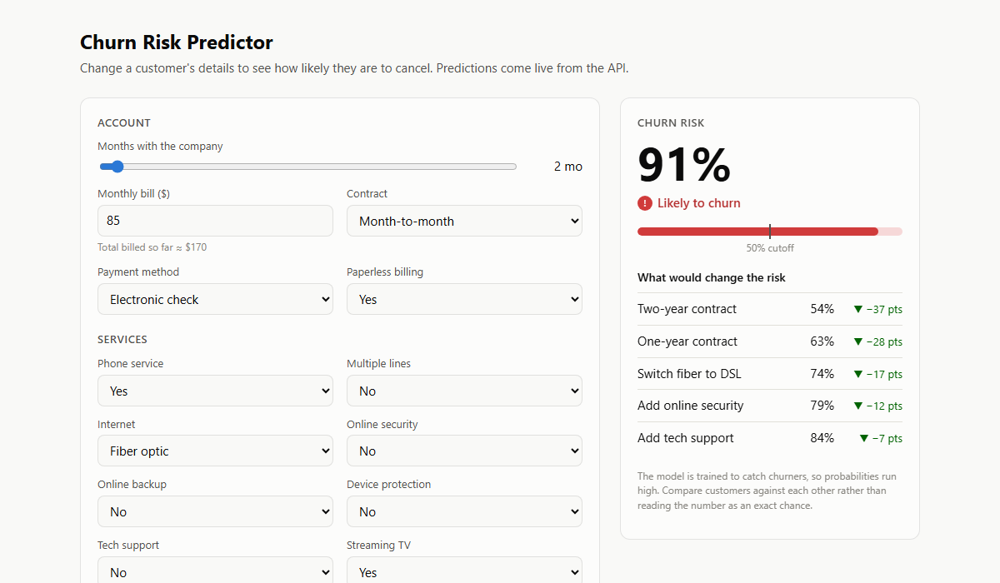
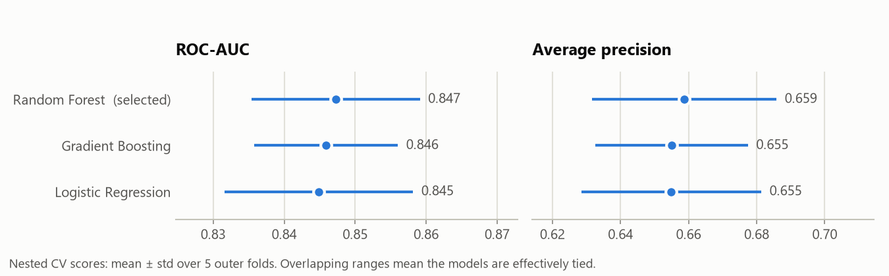
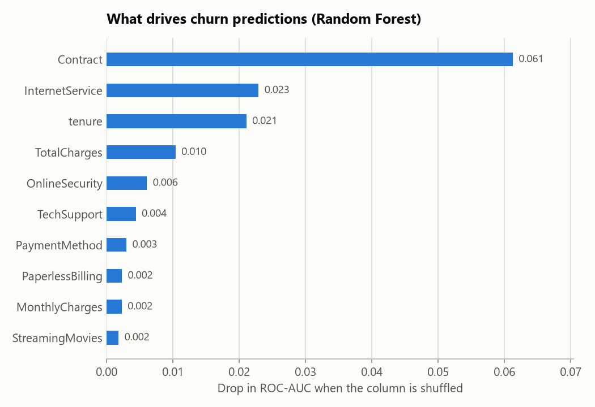
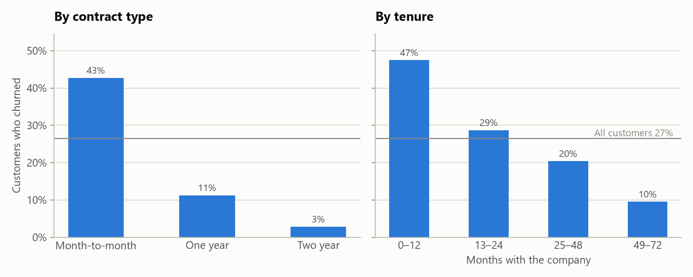
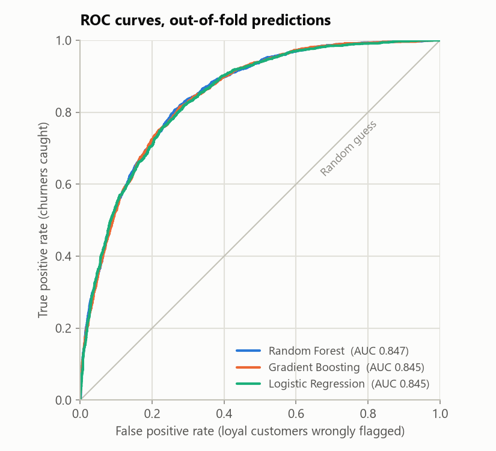

# Customer Churn Prediction System

Predicts how likely a telecom customer is to cancel their service, based on details like tenure, monthly bill, contract type and internet service.

The project covers the full path from raw data to a working service: data cleaning, model selection with nested cross-validation, a REST API with input validation, an interactive web page, and a test suite.



## Features

- **Nested cross-validation** compares three models and reports scores that aren't inflated by hyperparameter tuning
- **FastAPI service** with single and batch prediction endpoints, strict input validation and a health check
- **Web page** where you can edit a customer's details, watch the churn risk update live, and see which changes would lower it
- **Result charts** generated automatically after each training run
- **24 tests** covering data cleaning, training, the API and bad-input handling

## Results

Scores are the mean ± standard deviation across 5 outer folds. Every score is measured on customers that the model never saw during training or tuning.

| Model | ROC-AUC | Avg. precision | F1 | Precision | Recall | Accuracy |
|---|---|---|---|---|---|---|
| **Random Forest** (selected) | **0.847 ± 0.012** | 0.659 ± 0.027 | 0.636 ± 0.012 | 0.530 ± 0.010 | 0.795 ± 0.016 | 0.758 ± 0.008 |
| Gradient Boosting | 0.846 ± 0.010 | 0.655 ± 0.022 | 0.630 ± 0.007 | 0.517 ± 0.007 | 0.806 ± 0.011 | 0.749 ± 0.005 |
| Logistic Regression | 0.845 ± 0.013 | 0.655 ± 0.026 | 0.625 ± 0.009 | 0.512 ± 0.007 | 0.803 ± 0.016 | 0.745 ± 0.005 |



Random Forest had the highest mean ROC-AUC, but the gap between the three models (0.002) is much smaller than the variation between folds (about 0.012). In practice they are tied. Logistic Regression would be a reasonable choice in production, since it's faster and easier to explain.

The model catches about 80% of customers who leave (recall), and about half of the customers it flags actually leave (precision). That trade-off suits a retention team, where contacting a customer who would have stayed costs much less than losing one.

### What drives churn



Contract type is by far the strongest signal, followed by internet service type and tenure. Importance is measured by shuffling one column at a time and seeing how much the score drops on held-out customers.



Month-to-month customers churn at 43%, compared with 3% on two-year contracts. Customers in their first year churn at 47%.



## Why nested cross-validation

Picking hyperparameters and measuring performance on the same data gives an optimistic score, because the chosen settings are the ones that happened to work best on those test folds.

Nested cross-validation keeps these two jobs separate:

```
Outer loop (5 folds): measures performance
│
├── Hold out 1 fold as the test set
│
├── Inner loop (3 folds), on the remaining 4 folds only:
│     try every hyperparameter setting and keep the best
│
├── Retrain with the best setting on those 4 folds
│
└── Score once on the held-out fold
```

The held-out fold is never used for tuning, so the average of the 5 outer scores is an honest estimate of how the whole process (tuning plus training) performs on new customers. After model selection, the winning model is tuned and trained on all of the data and saved.

Preprocessing (one-hot encoding and scaling) lives inside each model's scikit-learn `Pipeline`, so it is fit on the training folds only and never sees test data.

## Getting started

Requires Python 3.10 or newer.

```bash
git clone https://github.com/AndrewMansur/Customer-Churn-Prediction-System-with-Nested-Cross-Validation.git
cd Customer-Churn-Prediction-System-with-Nested-Cross-Validation

python -m venv .venv
.venv\Scripts\activate          # Windows
source .venv/bin/activate       # macOS / Linux

pip install -r requirements.txt
pip install -e .
```

### Train the model

```bash
python -m churn.train
```

This runs nested cross-validation (about a minute), saves the model to `models/churn_model.joblib`, and writes the results table and charts to `reports/`.

Options: `--outer-folds`, `--inner-folds`, `--seed`. To redraw the charts without retraining, run `python -m churn.plots`.

### Run the API

```bash
uvicorn churn.api:app --reload
```

- Web page: http://127.0.0.1:8000
- Interactive API docs: http://127.0.0.1:8000/docs

### Run the tests

```bash
pytest
```

## API

| Method | Endpoint | Description |
|---|---|---|
| `GET` | `/health` | Whether the server is up and the model is loaded |
| `POST` | `/predict` | Churn probability for one customer |
| `POST` | `/predict/batch` | Churn probabilities for up to 1,000 customers |

Example request:

```bash
curl -X POST http://127.0.0.1:8000/predict \
  -H "Content-Type: application/json" \
  -d '{
    "SeniorCitizen": 0, "tenure": 2, "MonthlyCharges": 85.0, "TotalCharges": 170.0,
    "gender": "Female", "Partner": "No", "Dependents": "No",
    "PhoneService": "Yes", "MultipleLines": "No", "InternetService": "Fiber optic",
    "OnlineSecurity": "No", "OnlineBackup": "No", "DeviceProtection": "No",
    "TechSupport": "No", "StreamingTV": "Yes", "StreamingMovies": "Yes",
    "Contract": "Month-to-month", "PaperlessBilling": "Yes",
    "PaymentMethod": "Electronic check"
  }'
```

Response:

```json
{ "churn_probability": 0.9077, "will_churn": true, "threshold": 0.5 }
```

Every field is required, and categorical fields only accept the values seen in training. Invalid input, such as `"Contract": "banana"`, a negative tenure or an unknown field, is rejected with a `422` response that explains the problem. If the model file is missing, the server still starts, `/health` reports `model_not_loaded`, and prediction requests return `503`.

| Environment variable | Default | Purpose |
|---|---|---|
| `CHURN_MODEL_PATH` | `models/churn_model.joblib` | Model file to load |
| `CHURN_THRESHOLD` | `0.5` | Probability at or above which `will_churn` is true |


## Data cleaning notes

- `TotalCharges` is stored as text in the raw file. The 11 blank values all belong to customers with a tenure of 0 who haven't been billed yet, so they are set to 0. A blank value for any other customer raises an error instead of being filled in silently.
- `customerID` is dropped because it carries no predictive signal.
- About 26.5% of customers churned. All models use balanced class weights, and the folds are stratified so each one keeps the same churn rate.

## Limitations

- **Probabilities run high.** Balanced class weights help the model catch churners but push all probabilities upward, so a score is best used to rank customers rather than read as an exact chance. Calibrating the model would fix this.
- **The dataset is a single snapshot.** It has no timestamps, so the model can't account for changes in customer behavior over time.
- **The web page estimates total charges** as tenure × monthly bill rather than asking for it.

## Tech stack

Python, pandas, scikit-learn, FastAPI, Pydantic, Uvicorn, matplotlib, pytest

## Dataset

[IBM Telco Customer Churn](https://www.kaggle.com/datasets/blastchar/telco-customer-churn): 7,043 customers, 19 features.
